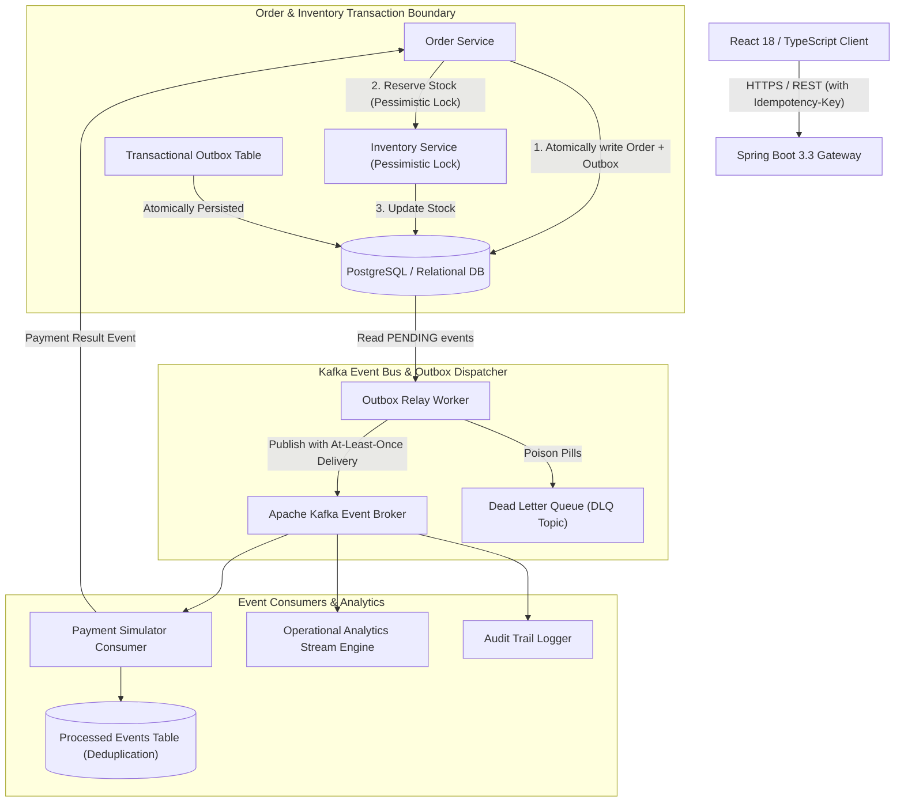
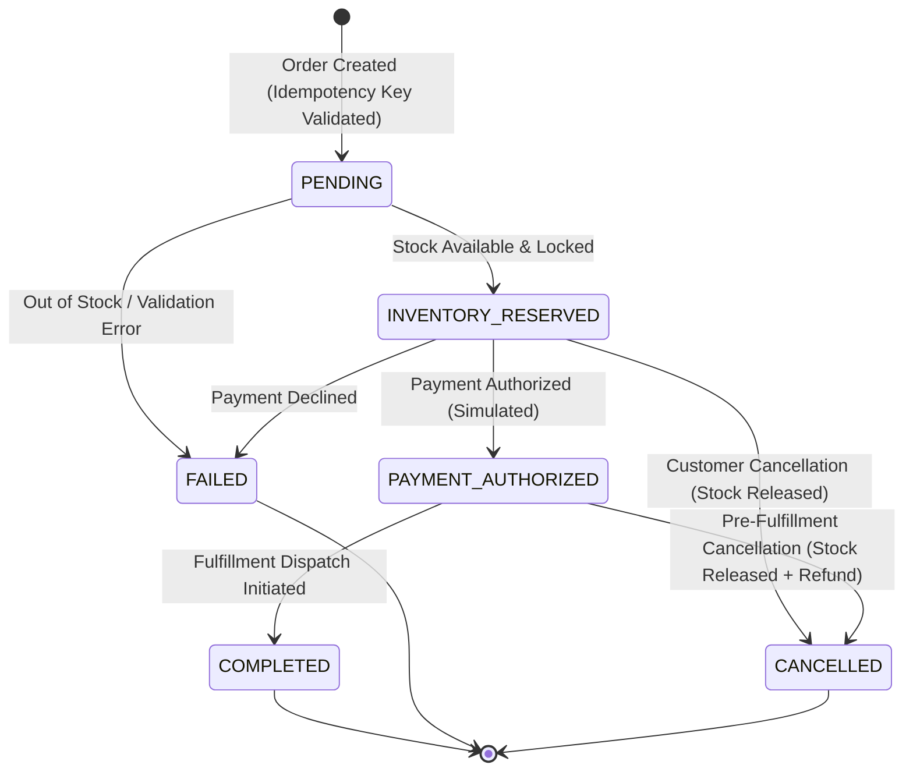

# Architecture Decision & Technical Specification

## 1. System Overview & Domain Boundaries
The **Event-Driven Commerce Intelligence Platform** solves the fundamental distributed systems challenge of maintaining inventory correctness, reliable asynchronous order state transitions, and real-time operational analytics under concurrent load and worker failures.



---

## 2. Order Lifecycle State Machine
Orders transition strictly through verified state transitions. Illegal or out-of-order transitions are rejected:



---

## 3. Distributed Correctness & Delivery Guarantees

### 3.1 Concurrency & Overselling Prevention
When two or more requests compete for the final unit of stock:
1. `InventoryService` acquires a pessimistic write lock:
   ```sql
   SELECT * FROM inventory WHERE sku = :sku FOR UPDATE
   ```
2. The transaction inspects `available_stock = total_stock - reserved_stock`.
3. If `available_stock >= requested_qty`, `reserved_stock` is incremented and transaction commits.
4. If `available_stock < requested_qty`, an `InsufficientStockException` is raised immediately.
5. Concurrent requests block until the lock releases, guaranteeing zero overselling without race conditions.

### 3.2 Idempotent Order Creation
Clients provide a unique `Idempotency-Key` header (UUIDv4) with order submissions:
1. The server checks the `idempotency_keys` table.
2. If the key exists:
   - If the previous request is still in progress, return `409 Conflict`.
   - If completed, return the cached HTTP response and order ID immediately without repeating business side effects.
3. If new, the key is reserved, the order is created, and the response is cached.

### 3.3 Transactional Outbox Pattern
To prevent dual-write failure (where database updates succeed but Kafka publishing fails, or vice-versa):
- Orders and domain events are written into the database within the **same local ACID transaction**:
  ```java
  orderRepository.save(order);
  outboxEventRepository.save(new OutboxEvent("Order", order.getId(), "OrderCreated", payloadJson));
  ```
- An asynchronous relay worker reads uncommitted outbox records, publishes to Kafka, and marks records as `PROCESSED`.

### 3.4 Consumer Deduplication & Dead-Letter Queue (DLQ)
- Consumers check event IDs against `processed_events` before executing side effects. If an event is re-delivered due to a consumer restart or network retry, the duplicate is acknowledged and safely discarded.
- Poison pills (malformed payloads or unrecoverable business errors) are routed to `commerce.dlq` after 3 failed retries, accompanied by error metadata for operational inspection.
